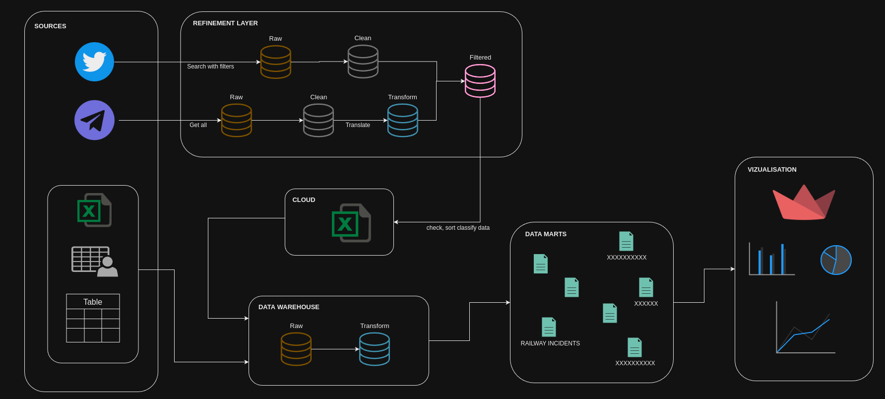

# Russia-Ukraine War Analytics Hub 🇺🇦🇷🇺

Repo featuring a wealth of data, graphs and analyses relating (directly or indirectly) to the war between Russia and Ukraine.

 

<!--toc:start-->

- [📊 Applications Web](#📊-applications-web)
- [Sections](#sections)
  - [🚂 Incidents Russian Railways Analytics](#🚂-incidents-russian-railways-analytics-🇷🇺)
    - [Overview Tab](#overview-tab)
    - [Incidents Types Tab](#incidents-types-tab)
    - [Damaged Equipments Tab](#damaged-equipments-tab)
    - [Collisions Tab](#collisions-tab)
    - [Sabotage Tab](#sabotage-tab)
    - [Partisans Arrest Tab](#partisans-arrest-tab)
  - [🚫 Websites Blocked in Russia](#🚫-websites-blocked-in-russia)
  - [⚙️ Components in Aggressor's Weapon](#️-components-in-aggressors-weapon)
  - [🪖 Military Losses in Ukraine](#🪖-military-losses-in-ukraine)
  - [🚨 Raid Alerts in Ukraine](#🚨-raid-alerts-in-ukraine)
  - [🗺️ Interactive Maps](#🗺️-interactive-maps)
- [Architecture](#architecture)

<!--toc:end-->

 

## 📊 Application Web

## Sections

### 🚂 Incidents Russian Railways Analytics 🇷🇺

This section contains data and analyses related to incidents involving Russian Railways, including accidents, fire, derailments, disruptions, and other significant events.

Data sources from Telegram channels and Twitter are collected, filtered, and pre-classified (with AI agents) to identify relevant incidents.

- **[Dataset Incidents Russian Railway](https://docs.google.com/spreadsheets/d/1jyD1bB0uauqIo-Bsi_qoBqV9JAu7cUXvG0UzZmFrSPk/edit?pli=1&gid=0#gid=0)**

#### Overview Tab

| Title                                                          | Subtitle                                                                    |
| :------------------------------------------------------------- | :-------------------------------------------------------------------------- |
| Annual Railway Incidents in Russia                             | Frequency of railway incidents per year                                     |
| Monthly Incident Trends on Russian Railways                    | Timeline showing monthly volume trends of railway incidents                 |
| Monthly Incident Trends on Russian Railways                    | Comparative view of total incidents per month                               |
| Railway Incidents by Type in Russia                            | Breakdown of incidents categorized by incident classification               |
| Railway Damaged Equipments in Russia                           | Overview of damaged equipment involved across railway incidents             |
| Distribution of Railway Incidents by Region in Russia          | Hierarchical breakdown of railway incidents across Russian regions          |
| Geographic Distribution of Sabotages on Russian Railways       | Spatial distribution and mapping of recorded sabotage events                |
| Distribution of Railway Incidents by Day of the Week in {year} | Matrix highlighting daily incident intensity across months for a given year |

 

#### Incidents Types Tab

| Title                                              | Subtitle                                                                            |
| :------------------------------------------------- | :---------------------------------------------------------------------------------- |
| Distribution of Incidents by Type                  | Overall breakdown of reported incidents categorized by type                         |
| Trends in Cumulative Incidents by Type Over Time   | Running cumulative count of incidents over time segmented by type                   |
| Incidents by Type: Yearly Comparison               | Year-over-year comparison showing incident volume by category                       |
| Monthly Incidents by Type                          | Temporal monthly trends of incidents broken down by category                        |
| Distribution of Damaged Equipment by Incident Type | Breakdown showing equipment damage totals for each incident type                    |
| Flow of Damaged Equipment by Incident Type         | Relationship flow illustrating how specific incident types lead to equipment damage |
| Distribution of Incidents by Type and Region       | Regional breakdown of incidents categorized by incident classification              |

 

#### Damaged Equipments Tab

| Title                                               | Subtitle                                                                                       |
| :-------------------------------------------------- | :--------------------------------------------------------------------------------------------- |
| Distribution of Damaged Equipments                  | Overall count and breakdown of damaged equipment across all incidents                          |
| Trends in Cumulative Damaged Equipments Over Time   | Cumulative growth trajectory of damaged equipment over time                                    |
| Damaged Equipment: Yearly Comparison                | Annual comparison of equipment damage instances                                                |
| Monthly Damaged Equipments                          | Detailed monthly view of damaged equipment counts                                              |
| Distribution of Incident Types by Damaged Equipment | Multi-tiered hierarchical breakdown showing incident types within equipment categories         |
| Flow of Incident Types by Damaged Equipment         | Mapping connection flows between damaged equipment types and corresponding incident categories |
| Distribution of Damaged Equipments by Region        | Regional comparative view of equipment damage occurrences                                      |

 

#### Collisions Tab

| Title                                              | Subtitle                                                              |
| :------------------------------------------------- | :-------------------------------------------------------------------- |
| Distribution of Collisions                         | Proportion of collisions relative to overall incident types           |
| Monthly Collisions                                 | Temporal monthly frequency of collision events                        |
| Distribution of Collisions by Implicated Equipment | Breakdown of collisions categorized by the primary equipment involved |
| Monthly Implicated Equipments in Collisions        | Monthly trends of specific equipment involved in collision events     |

 

#### Sabotage Tab

| Title                                                        | Subtitle                                                                          |
| :----------------------------------------------------------- | :-------------------------------------------------------------------------------- |
| Annual Number of Sabotage                                    | Total recorded sabotage events grouped by year                                    |
| Monthly Number of Sabotage by Year                           | Monthly sabotage activity trends compared across years                            |
| Incidents vs Sabotage over Time                              | Comparative timeline measuring total incidents against targeted sabotage events   |
| Distribution of Sabotage by Partisans Group                  | Proportion of sabotage events attributed to specific partisan groups              |
| Sabotage Incidents by Partisans Group                        | Timeline mapping individual sabotage incidents by partisan group and date         |
| Treemap of Damaged Equipment with Partisan Group Attribution | Hierarchical layout of damaged equipment organized by responsible partisan groups |
| Implication of Partisans Group in Damaged Equipment          | Extent of involvement for each partisan group regarding equipment damage          |
| Treemap of Partisan Groups and Associated Equipment Damage   | Hierarchical structure mapping partisan groups to specific equipment damages      |
| Distribution of damaged equipment of partisan groups         | Volume of equipment damage attributed across partisan organizations               |
| Distribution of Damaged Equipment for Sabotage Incidents     | Share of specific equipment types damaged strictly in sabotage cases              |
| Monthly Number of Damaged Equipments                         | Line                                                                              | Temporal monthly trajectory of equipment damaged via sabotage    |
| Number of Damaged Equipments by Region                       | Bar                                                                               | Geographical distribution of equipment damage caused by sabotage |
| Geographic Distribution of Sabotages on Russian Railways     | Map                                                                               | Geographic plot of railway sabotage locations across regions     |

 

#### Partisans Arrest Tab

| Title                                                  | Subtitle                                                                     |
| :----------------------------------------------------- | :--------------------------------------------------------------------------- |
| Funnel of Partisans Arrested                           | Conversion stage mapping showing progression of partisan arrests             |
| Distribution of Sabotage where partisans were arrested | Proportion of sabotage events resulting in partisan detentions               |
| Distribution of Applicable Laws                        | Hierarchical view of legal statutes applied to detained partisans            |
| Number of Partisans Age                                | Grid layout displaying age composition of arrested partisans                 |
| Number of Partisans Arrested by Age                    | Cumulative step analysis of arrested partisans grouped by exact age          |
| Number of Partisans Arrested by Age Group              | Sequential age bracket analysis of partisan arrest metrics                   |
| Applicable Laws by Partisans Age                       | Correlation matrix mapping applied legal charges against partisan age groups |

 

### 🚫 Websites Blocked in Russia

This section provides charts of websites that have been blocked in Russia, including those blocked by Roskomnadzor and other entities.

- **[Data Source](https://www.top10vpn.com/research/websites-blocked-in-russia/)**

| Title                                                           | Subtitle                                                                                                |
| :-------------------------------------------------------------- | :------------------------------------------------------------------------------------------------------ |
| Countries With Most Blocked Domains                             | Top 30 countries ranked by the number of blocked domain websites                                        |
| Subcategories of Websites Blocked in Russia                     | Top 30 subcategories of blocked websites                                                                |
| Categories of Websites Blocked                                  | Overall distribution of blocked websites sorted by high-level category                                  |
| Russian authorities most active in censoring websites           | Breakdown of website blocks categorized by the responsible banning authority                            |
| Countries where websites are blocked in Russia                  | Geographical distribution showing global volume of blocked websites targeting specific country domains  |
| Blocked Websites by Year                                        | Annual count of website blocks in Russia since 2022                                                     |
| Blocked Websites by Month                                       | Monthly temporal trend of website blocks since 2022                                                     |
| Blocked Websites by Day                                         | Daily granularity view showing blocked website volume since 2022                                        |
| Cumulative Total of Blocked Websites Over Time                  | Running total / cumulative growth of blocked websites over time                                         |
| Blocked Websites by Day in 2022                                 | Daily intensity pattern matrix (Day vs Month) for blocks occurring in 2022                              |
| Blocked Websites by Day in 2023                                 | Daily intensity pattern matrix (Day vs Month) for blocks occurring in 2023                              |
| Blocked Websites by Day in 2024                                 | Daily intensity pattern matrix (Day vs Month) for blocks occurring in 2024                              |
| Censorship Activity by Russian Authorities                      | Monthly volume of website blocks segmented by the enforcing regulatory authority                        |
| Content Categories Targeted for Blocking                        | Monthly breakdown of blocked websites categorized by content type                                       |
| Website Blocking Trends by Country                              | Monthly distribution of blocked website domains across top 25 target countries                          |
| Mapping Censorship: Authorities and Targeted Content Categories | Flow mapping showing relationships and volume links between authorities and censored content categories |
| Top Blocked Website Categories by Country in Russia             | Hierarchical breakdown displaying top categories within the top 6 target countries                      |
| Blocked Websites by Country and Category                        | Distribution of website categories across remaining target countries                                    |

 

### 🪖 Military Losses in Ukraine

This section provides data and analyses related to military losses in Ukraine, including personnel, equipment, and other relevant information.

| Title                                                                                                                                              | Description                                        |
| -------------------------------------------------------------------------------------------------------------------------------------------------- | -------------------------------------------------- |
| [Equipment losses & Death Toll & Military Wounded & Prisoner of War of Russians](https://www.kaggle.com/datasets/piterfm/2022-ukraine-russian-war) | Dataset on Russian military losses in Ukraine.     |
| [UA losses](https://ualosses.org/en/soldiers/)                                                                                                     | Ukrainian military losses tracker.                 |
| [Russian Losses in Ukraine](https://www.ukrainewarlosses.com/)                                                                                     | Tracker for Russian military losses.               |
| [Russian Casualties in Ukraine](https://russian-casualties.in.ua/)                                                                                 | Data on Russian casualties in Ukraine.             |
| [Russo-Ukrainian Warspotting](https://ukr.warspotting.net/)                                                                                        | Warspotting data for the Russo-Ukrainian conflict. |

 

### 🚨 Raid Alerts in Ukraine

This section provides data related to raid alerts in Ukraine, multiple sources are available.

| Title                                                                                              | Description                                                   |
| -------------------------------------------------------------------------------------------------- | ------------------------------------------------------------- |
| [Air Raid Alert Map of Ukraine](https://alerts.in.ua/en)                                           | Map of air raid alerts in Ukraine.                            |
| [Air-alarms.in.ua](https://air-alarms.in.ua/en)                                                    | Statistics of air alerts in Ukraine.                          |
| [Ukrainian Air Raid Sirens Dataset](https://github.com/Vadimkin/ukrainian-air-raid-sirens-dataset) | GitHub repository with the Ukrainian Air Raid Sirens Dataset. |

 

### 🗺️ Interactive Maps

This section provides lists of interactive maps related to the war in Ukraine.

| Map Title                                                                                                                                             | Description                                                                                                                                                                                                                                                                                                                   |
| ----------------------------------------------------------------------------------------------------------------------------------------------------- | ----------------------------------------------------------------------------------------------------------------------------------------------------------------------------------------------------------------------------------------------------------------------------------------------------------------------------- |
| [Russo-Ukrainian War Tracker](https://ukrainewar.app/?events=true)                                                                                    | An independent research project visualizing the Russo-Ukrainian War through territory control, military losses, humanitarian impact, and international aid from February 2022 to the present.                                                                                                                                 |
| [DeepState Map of Ukraine](https://deepstatemap.live/en#6/50.0571388/32.7612305)                                                                      | News of russia's war against Ukraine on the map.                                                                                                                                                                                                                                                                              |
| [UA Control Map](https://www.google.com/maps/d/u/0/viewer?mid=1xPxgT8LtUjuspSOGHJc2VzA5O5jWMTE&ll=47.50751714509709%2C34.14477250205766&z=6)          | UA Control And Units Map.                                                                                                                                                                                                                                                                                                     |
| [War Mapper](https://www.warmapper.org/)                                                                                                              | Understand the impact of the frontline changes in Ukraine through a series of control charts.                                                                                                                                                                                                                                 |
| [Eyes on Russia](https://eyesonrussia.org/)                                                                                                           | Map draws on the database of videos, photos, satellite imagery or other media related to Russia’s invasion of Ukraine.                                                                                                                                                                                                        |
| [ISW: Russian Military Objects Are in Range of ATACMS](https://understandingwar.org/analysis/map-room/?_search_research=ATACMS&_teams=russia-ukraine) | Map allows users to inspect 225 known Russian military objects in Russia that are in range of Ukrainian ATACMS.                                                                                                                                                                                                               |
| [ISW: Interactive Map: Russia's Invasion of Ukraine](https://understandingwar.org/analysis/map-room/?_search_research=control&_teams=russia-ukraine)  | Interactive maps complements the static control-of-terrain maps that ISW daily produces with high-fidelity and, where possible, street level assessments of the war in Ukraine.                                                                                                                                               |
| [Ukraine Conflict Monitor](https://acleddata.com/monitor/ukraine-conflict-monitor)                                                                    | ACLED’s Ukraine Conflict Monitor provides near real-time information on the ongoing war, including an interactive map, data file, weekly situation updates. Designed to help researchers, policymakers, media, and the wider public track key conflict developments in Ukraine.                                               |
| [Air Raid Alert Map of Ukraine](https://alerts.in.ua/en)                                                                                              | Showcases air raid alerts across Ukraine on an interactive map, providing real-time updates on siren activations and safety information.                                                                                                                                                                                      |
| [Ukraine Daily Updates](https://map.ukrdailyupdate.com/?lat=49.385949&lng=32.744751&z=7&d=20384&c=1&l=0)                                              | Map maintained by Andrew Perpetua, providing the daily events of this war and the current situation on the battlefield. Notable events affecting military targets and civilian victims, fortifications and much more is shown through the map’s adjustable layers.                                                            |
| [Timeline of Invasion](https://www.google.com/maps/d/u/0/embed?mid=1lscRK6ehG0l2V-XvJ16nsyblMsQ&ll=48.32028801617995%2C38.452502603277026&z=8)        | Map by David Batashvili, visualize the movements of armies during Russia's invasion of Ukraine from February 24, 2022.                                                                                                                                                                                                        |
| [Civilian Harm Map](https://ukraine.bellingcat.com/)                                                                                                  | Incidents in Ukraine that have resulted in potential civilian harm. These include: incidents where rockets or missiles struck civilian areas, where attacks have resulted in the destruction of civilian infrastructure, where the presence of civilian injuries are visible and/or the presence of immobile civilian bodies. |
| [Fortifications in Ukraine](https://militarysummary.com/map)                                                                                          | Map showing fortifications in Ukraine including trenches, bunkers, and other defensive structures built during the conflict.                                                                                                                                                                                                  |
| [The Undeniable Street View](https://theundeniablestreetview.com/)                                                                                    | Through Street View, walk the streets of 6 Ukrainian cities and regions that have found themselves on the front line and witness the Russian aggression against civilian infrastructure up close.                                                                                                                             |

 
 

## Architecture

